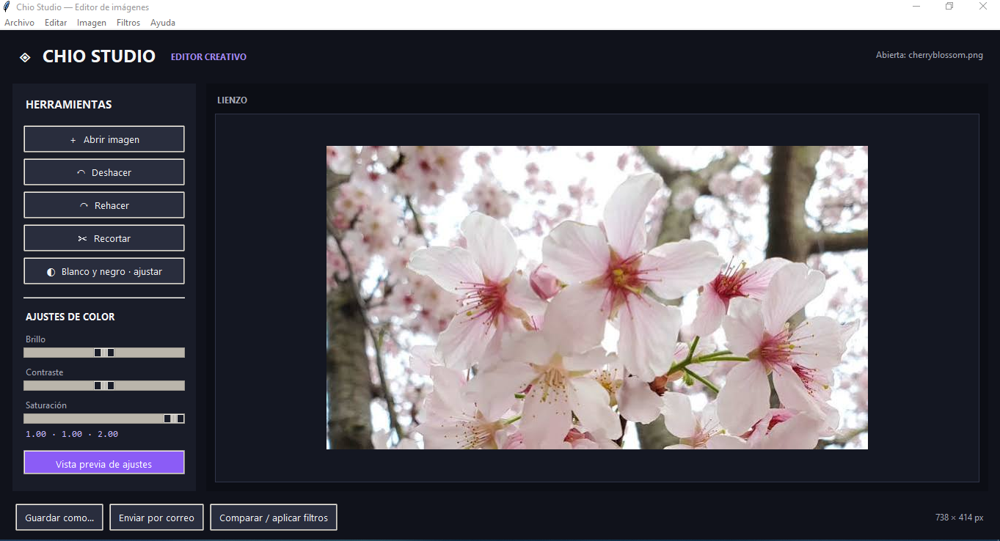
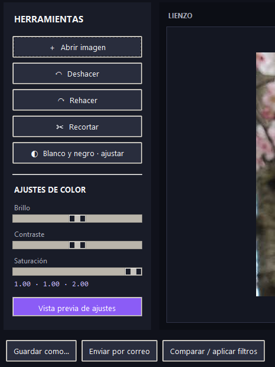
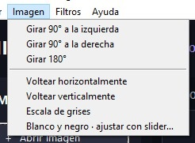
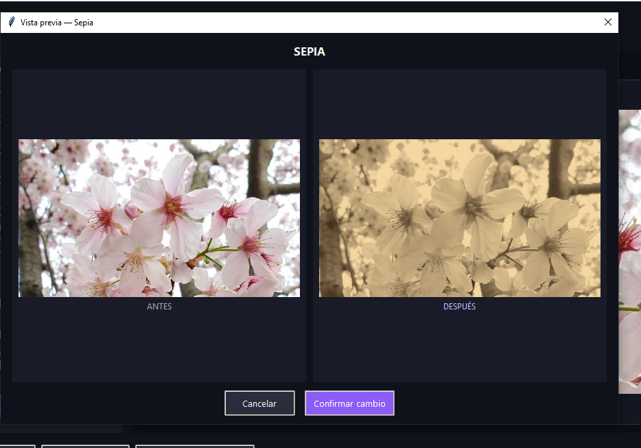
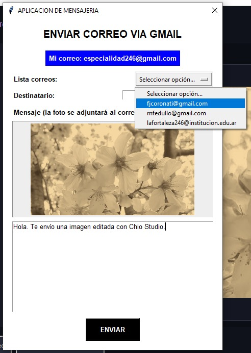
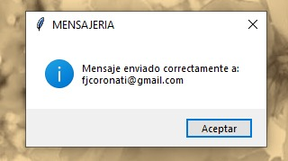

Editor de imágenes Chio Studio - Programación II

Este editor es una aplicación desarrollada en Python,
utilizando Tkinter para crear su interfaz gráfica y Pillow para trabajar con las imágenes.

La aplicación cuenta con diferentes herramientas de edición, como recortar imágenes, aplicar filtros,
modificar el brillo, el contraste y la saturación, rotar y voltear imágenes, entre otras funciones.

También permite visualizar los cambios antes de aplicarlos definitivamente,
recuperar modificaciones anteriores mediante un historial y enviar imágenes por correo electrónico.

El programa fue pensado para que cualquier usuario pueda utilizar sus herramientas de forma didáctida,
esto es gracias a una interfaz gráfica organizada.

*Capturas de pantalla:

Ventana principal

Herramientas de edición

Vista previa de los cambios

Ventana de envío por correo

*Ejecución de el archivo .exe

Para hacerlo:

Ingresar al repositorio de GitHub.

Dirigirse a la sección Releases.

Descargar el archivo ejecutable .exe

Guardarlo en una carpeta del equipo.

Hacer doble clic sobre el archivo .exe para iniciar la aplicación.

El ejecutable debe incluir los recursos necesarios para su funcionamiento, como los archivos de sonido personalizados.

* Configuración del correo electrónico:

Para utilizar la función de envío de imágenes por correo electrónico es necesario configurar las credenciales
y los datos del servidor de correo.

La aplicación utiliza las variables de entorno para evitar escribir información privada directamente dentro del código.

Las variables utilizadas para configurar el servicio son:

LUMINA_EMAIL: dirección de correo electrónico del remitente.

LUMINA_SMTP: servidor SMTP utilizado para enviar los mensajes.

LUMINA_PORT: puerto de conexión del servidor.

* Guía de uso:

A continuación, se explica cómo utilizar las principales herramientas de la aplicación:

Abrir una imagen

Iniciar el Editor.

Ingresar al menú Archivo.

Seleccionar la opción para abrir una imagen.

Elegir el archivo desde el explorador de Windows.

La imagen seleccionada aparecerá en el área de trabajo.

La aplicación permite seleccionar imágenes desde el equipo, sin necesidad de modificar el código.

* Para editar una imagen:

Seleccionar una imagen.

Ingresar al menú correspondiente a la herramienta que se desea utilizar.

Elegir la transformación o ajuste.

Observar el resultado en la vista previa.

Presionar el botón Confirmar para aplicar los cambios o Cancelar para descartarlos.

*Para recortar una imagen:

Seleccionar la herramienta de recorte.

Marcar con el mouse el área que se desea conservar.

Modificar los bordes de selección si es necesario.

Presionar Listo para confirmar el recorte.

* Para guardar una imagen:

Ingresar al menú Archivo.

Seleccionar la opción Guardar como.

Elegir la ubicación donde se desea guardar el archivo.

Escribir el nombre de la imagen.

Seleccionar el formato correspondiente.

Confirmar el guardado.

* Para enviar una imagen por correo electrónico:

Abrir la ventana de envío por correo.

Ingresar la dirección de Gmail del remitente.

Seleccionar un destinatario de la lista o escribir una dirección manualmente.

Comprobar que la imagen que se desea enviar sea la correcta.

Presionar el botón de envío.

Esperar la confirmación del resultado.

Si la imagen supera el tamaño permitido, la aplicación realiza una reducción leve de su tamaño 
o calidad para poder enviarla.

* Menú Archivo:

Permite administrar las imágenes dentro del programa.

Abrir: permite seleccionar una imagen desde el equipo.

Guardar como: permite guardar la imagen editada, eligiendo su nombre, ubicación y formato.

* Menú Editar:

Contiene las herramientas relacionadas con la modificación de las imágenes y el historial de trabajo.

Deshacer: permite volver al estado anterior de la imagen.

Rehacer: permite recuperar un cambio que se había deshecho.

Estas opciones permiten corregir errores y recuperar versiones anteriores sin tener que comenzar nuevamente.

*Menú Imagen:

Contiene las transformaciones principales de la imagen.

Voltear horizontalmente: invierte la imagen de izquierda a derecha.

Voltear verticalmente: invierte la imagen de arriba hacia abajo.

Rotar 90° a la izquierda: gira la imagen hacia la izquierda.

Rotar 90° a la derecha: gira la imagen hacia la derecha.

Rotar 180°: gira la imagen completamente.

Escala de grises: transforma la imagen a diferentes tonos de gris.

Blanco y negro: convierte la imagen en dos colores, blanco y negro, mediante un umbral ajustable.

Recortar: permite seleccionar y conservar una parte específica de la imagen.

* Menú Filtros:

Permite modificar la apariencia de las imágenes mediante distintos efectos.

Desenfoque: suaviza la imagen y reduce la nitidez de sus detalles.

Negativo: invierte los colores originales de la imagen.

* Ajustes de imagen:

La aplicación permite modificar tres características principales mediante controles deslizantes:

Brillo: permite aumentar o disminuir la luminosidad.

Contraste: modifica la diferencia entre las zonas claras y oscuras.

Saturación: permite intensificar o reducir la intensidad de los colores.

*Vista previa antes y después:

Antes de aplicar definitivamente una modificación, el usuario puede observar una comparación
entre la imagen original y el resultado obtenido.
Esto permite comprobar si el cambio es el esperado antes de confirmarlo.
La aplicación cuenta con las opciones de confirmar o cancelar la operación.

* Historial de cambios:

El historial permite deshacer y rehacer las modificaciones realizadas durante la edición,
es decir, puede regresar a un estado anterior de la imagen.

* Sonido personalizado:

Cada vez que se confirma una modificación, la aplicación reproduce un sonido personalizado como WowAnime.wav.
permite acompañar las acciones realizadas y da una respuesta auditiva al usuario.

* Envío por correo electrónico:

La aplicación incorpora una ventana de mensajería que permite enviar imágenes como archivos adjuntos.

*Entre sus características se encuentran:

Ingreso del correo del remitente.

Selección o escritura manual del destinatario.

Vista previa de la imagen que se enviará.

Validación de la dirección de correo.

Compresión o reducción de la imagen cuando supera el tamaño permitido.

Manejo de errores relacionados con la conexión, las credenciales y los archivos.

Para realizar el envío se utilizan las librerías smtplib y email de Python.

Se utilizó un OptionMenu con los mails de profesores de la especialidad.

* Prueba de envío por correo electrónico y límite:

Una de las funciones obligatorias del proyecto es permitir el envío de imágenes por correo electrónico.
Los servicios de correo suelen establecer un límite de 25 MB para el mensaje completo. Sin embargo,
al adjuntar una imagen, el archivo se codifica para poder enviarse, lo que aumenta su tamaño.
Para solucionar este inconveniente, la aplicación contempla un proceso de reducción del tamaño
o de la calidad de la imagen cuando es necesario.
De esta manera, se busca que el mensaje completo, incluyendo el archivo adjunto y su codificación,
no supere el límite permitido.
Cuando se necesita realizar esta reducción, se informa al usuario antes del envío.

*Prueba real de funcionamiento:

*Limitaciones:

Como todo programa, puede presentar algunas limitaciones:

La aplicación depende de que el archivo seleccionado sea un formato de imagen compatible.

El envío por correo necesita conexión a internet.

Para utilizar el servicio de correo es necesario contar con credenciales correctamente configuradas.

La compresión puede modificar la calidad o las dimensiones de la imagen original.

El funcionamiento del ejecutable puede depender de los recursos que se hayan incluido al generarlo.

* Manejo de errores:

La aplicación contempla situaciones que pueden ocurrir durante su utilización, como:

Intentar abrir un archivo que no sea una imagen compatible.

Seleccionar un archivo dañado.

Cancelar la selección de una imagen.

Intentar guardar una imagen en un formato diferente.

Intentar enviar un correo con una dirección incorrecta.

No tener conexión a internet.

No tener las credenciales de correo configuradas.

Intentar enviar una imagen sin haber cargado ninguna.

El objetivo es informar al usuario sobre los problemas mediante mensajes de advertencia o error,
evitando que el programa se cierre inesperadamente.

Alumno: Andreoli, Ariana.

Institución: IPETyM N.º 246 «Dr. Amadeo Sabattini».

Materia: Programación II.

Curso: 5.º año.

Docente: Ing. Federico Coronati.

Año: 2026.

